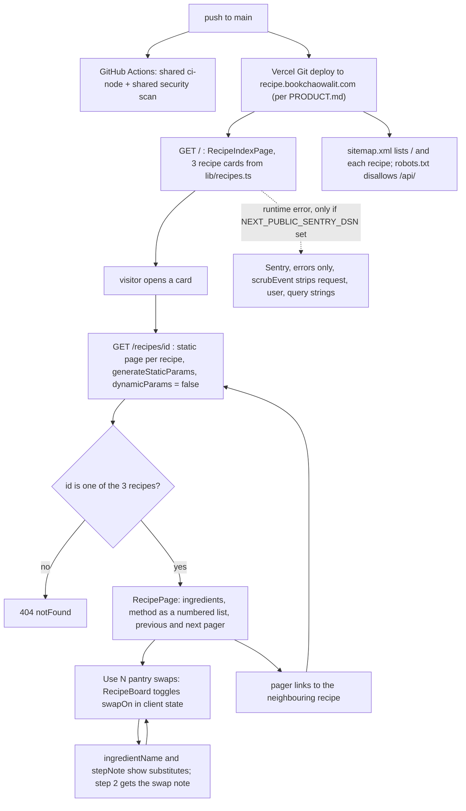

# 01 — Business process (As-Is / To-Be)

food-recipe-explorer-web คือเว็บ static (recipe.bookchaowalit.com) แสดงสูตรอาหารสังเคราะห์ 3 สูตร มีหน้ารายการและหน้าสูตรละหน้า พร้อมปุ่มสลับวัตถุดิบทดแทนจากตู้เก็บของ (pantry swap) ที่ทำงานฝั่ง browser

Last reviewed: 2026-11-28 · commit `5443d5b`

## As-Is (จากโค้ดวันนี้)

Sources: `app/page.tsx`, `app/recipes/[id]/page.tsx`, `components/recipe-pages.tsx`, `components/recipe-board.tsx`, `lib/recipes.ts`, `lib/site.ts`, `lib/sentry.ts`, `next.config.ts`, `PRODUCT.md`

ข้อเท็จจริงจากโค้ด: ไม่มี API route, storage หรือ network call ของตัวเอง; สถานะ swap ไม่ถูกเก็บ (รีโหลดแล้วปิด). วิธีทำเป็น numbered list ธรรมดา ไม่มีการเลือกขั้นหรือตัวนับ `02 / 3` (ตาม PRODUCT.md §Known limits; `stepCounter` และ `prepNote` ยังอยู่ใน `lib/recipes.ts` แต่หน้าไม่เรียก). [ต้องยืนยัน] สถานะ deploy ปัจจุบัน (PRODUCT.md บันทึกเมื่อ 2026-10-23 ว่า commit ใหม่ชนข้อจำกัด deploy ต่อวัน).

## To-Be

ไม่มี To-Be ที่เขียนไว้ (PRODUCT.md §Interaction contract ยังเล่าการเลือกขั้นตอน แต่ §Known limits ระบุว่าไม่เป็นจริงแล้ว และให้ owner ตัดสิน)

## Gap

| ID | As-Is → To-Be | Status | Owner | Evidence |
|---|---|---|---|---|
| G1 | ไม่มีการเลือกขั้นตอนและตัวนับขั้น (หายไปตอนย้ายเข้า Reader shell) → owner ตัดสินว่าจะคืนฟีเจอร์นี้หรือไม่ | decide | owner | `PRODUCT.md` §Known limits (Codex review 2026-11-20) |
| G2 | PRODUCT.md §What works และ §Interaction contract ยังบอกว่าเลือกขั้นได้และมีตัวนับ; README อ้าง `prepNote`/`stepCounter` ว่าหน้าใช้ → แก้เอกสารให้ตรงโค้ด (ตามผลของ G1) | todo | claude | `PRODUCT.md`; `README.md` §Code map; `components/recipe-board.tsx` |

## Open questions

- production ตาม `main` อยู่หรือไม่ (PRODUCT.md บันทึก deploy ที่ค้างจาก quota เมื่อ 2026-10-23)
